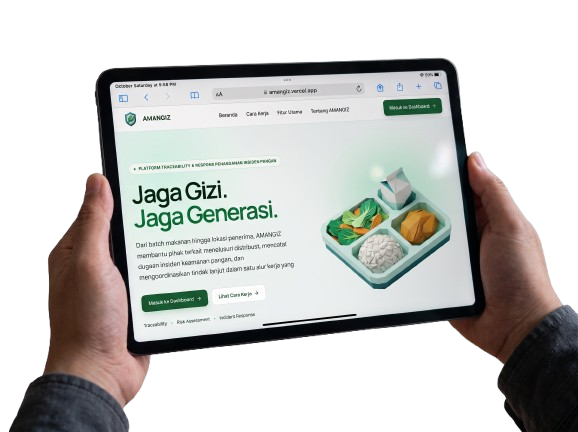
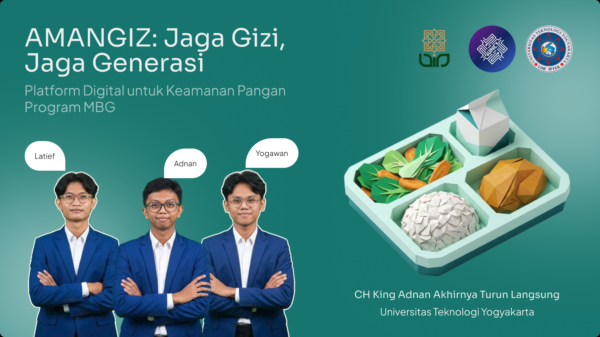
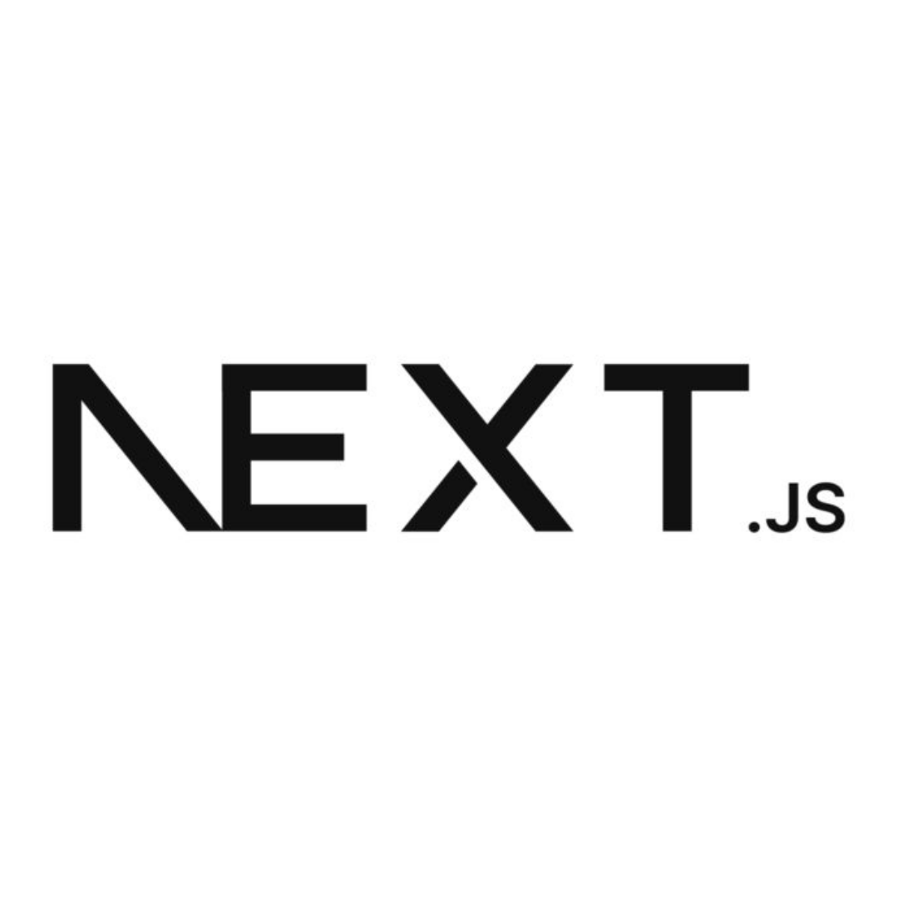
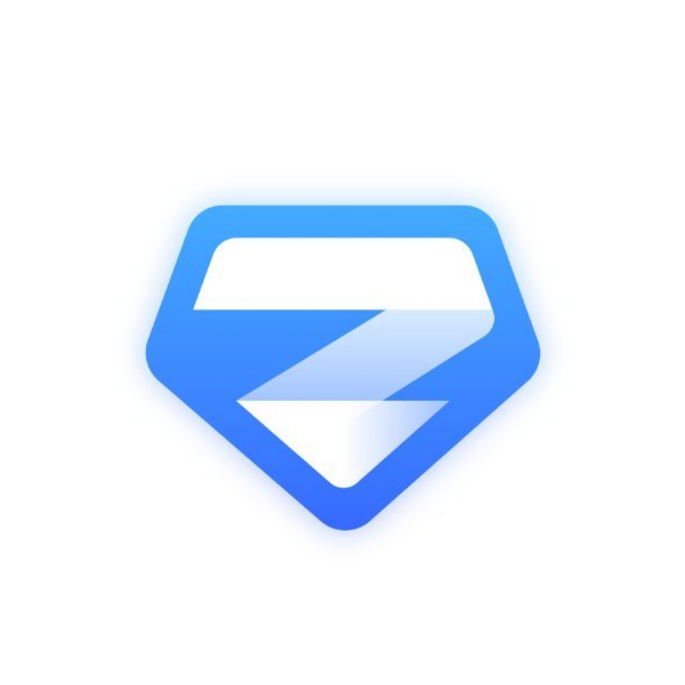

# AMANGIZ - Amankan Gizi

**Food Safety & Nutrition Incident Response Platform** for the *Program Makan Bergizi Gratis* (MBG) ecosystem.

*Jaga Gizi. Jaga Generasi.*

**[Live Demo > amangiz.vercel.app](https://amangiz.vercel.app)**

<p>
  
  
  
  
  
  
  
</p>

</div>

## Mockup Overview



## Deck Overview



Link deck: https://www.figma.com/deck/pT3c55UHHcqA3T9xFYIp5t

## AMANGIZ's Team

Meet the passionate team building AMANGIZ:

<table>
  <tr>
    <td align="center" width="33%">
      
      <br />
      <strong>Yogawan</strong>
      <br />
      Frontend Developer
      <br />
      <em>Building intuitive UI & seamless UX</em>
    </td>
    <td align="center" width="33%">
      
      <br />
      <strong>Adnan</strong>
      <br />
      UI/UX & Video Editor
      <br />
      <em>Crafting visual identity & storytelling</em>
    </td>
    <td align="center" width="33%">
      
      <br />
      <strong>Lathif</strong>
      <br />
      Backend & AI Developer
      <br />
      <em>Designing robust APIs & intelligent systems</em>
    </td>
  </tr>
</table>

---

## Table of Contents

- [Project Overview](#project-overview)
- [Background & Problem Statement](#background--problem-statement)
- [Solution](#solution)
- [Features](#features)
- [Demo & Screenshots](#demo--screenshots)
- [Technology Stack](#technology-stack)
- [System Architecture](#system-architecture)
- [Project Structure](#project-structure)
- [Getting Started](#getting-started)
  - [Prerequisites](#prerequisites)
  - [Installation](#installation)
  - [Environment Variables](#environment-variables)
  - [Development Server](#development-server)
- [Available Scripts](#available-scripts)
- [Roadmap](#roadmap)
- [Contributing](#contributing)
- [License](#license)

---

## Project Overview

AMANGIZ ("Amankan Gizi") is a food-safety traceability and incident-response platform built for Indonesia's **Program Makan Bergizi Gratis (MBG)** — the national free nutritious meals program. It gives system administrators, SPPG (meal production unit) operators, school operators, and food-safety investigators a single, structured workflow to:

- trace a food batch from supplier to the school that received it,
- report and prioritize suspected food-safety incidents,
- score incident priority with a transparent, rule-based risk engine, and
- document the full investigation and corrective-action trail.

**Core workflow:** `Detect → Trace → Assess → Contain → Investigate → Resolve`

**Current state.** All core workflows are implemented end to end — API and UI included: authentication, role-based access control, master-data management, batch management, distribution tracking, traceability, incident reporting, rule-based risk assessment, investigation & response, the operational dashboard, notifications, and the audit log. A public "Tentang Kami" page (`/about`) introduces the team behind the project. See [Roadmap](#roadmap) for what's next.

## Background & Problem Statement

### Context

The Free Nutritious Meals Program (*Program Makan Bergizi Gratis*) involves many parties: ingredient suppliers, SPPG kitchens (*Satuan Pelayanan Pemenuhan Gizi*), distribution staff, schools, and the students who receive the meals. Food safety has to be maintained at every handoff — from raw-ingredient receipt, through production, through distribution, to the moment a meal reaches its recipient.

When a food-safety incident is suspected, the people involved need to gather information quickly: which batch was involved, where it was distributed, what happened, and who needs to follow up. When that information lives in scattered, disconnected operational records, tracing a batch's history and coordinating a response takes longer than it should.

### Core Problems

| # | Problem | Description |
|---|---|---|
| A | **Information fragmentation** | Batch, supplier, production, distribution, and recipient data are often recorded in separate places, so reconstructing a batch's history means pulling information from multiple sources. |
| B | **Limited operational traceability** | When a batch is flagged, staff need a fast way to trace its ingredients and suppliers, the SPPG that produced it, production/distribution timing, the receiving schools, delivery status, and any related prior incidents. |
| C | **Hard-to-monitor incident handling** | Filing a report is only the start — each one needs evidence review, an initial risk read, possible containment, investigation, and documented resolution. Without a defined workflow, ownership and case stage become hard to track. |
| D | **Difficulty prioritizing risk** | Staff need a consistent way to decide which reports need attention first, based on signals such as reported affected count, suspected SOP violations, storage-temperature records, distribution delays, and documentation completeness. These signals can help prioritize review, but none of them — alone or combined — are proof of a cause. |

### Problem Statement

> How can an integrated web platform help the relevant parties trace a food batch's history, manage food-safety incident reports, prioritize risk-based review, and document follow-up in a structured, accountable way?

### Goals

1. Integrate food batch data with its distribution records.
2. Speed up tracing a batch's distribution destinations.
3. Centralize incident reports and supporting evidence.
4. Help staff prioritize response through rule-based risk assessment.
5. Provide a documented investigation and follow-up workflow.
6. Improve the traceability of operational activity and decisions.

## Solution

AMANGIZ connects food-batch data, distribution records, beneficiary information, incident reports, preliminary risk assessment, and investigation follow-up in a single workflow.

> **Scope note.** AMANGIZ does not diagnose illness, determine an incident's cause automatically, or replace the authority of medical professionals, laboratories, or official health bodies. It supports the people who do that work with organized, traceable information. Every risk score it produces is a triage aid, not a diagnosis or evidence of causation.

### Core Workflow

| Stage | What happens |
|---|---|
| **1. Detect** | An operator or staff member files an incident report: what happened, when, where, which batch, and supporting evidence. |
| **2. Trace** | The system follows the batch's relationships to its SPPG, shipments, and receiving schools, surfacing other distributions that may need review. |
| **3. Assess** | A rule-based risk engine evaluates the available signals and produces a priority level, showing exactly which rules fired and why. |
| **4. Contain** | Authorized roles can hold, release, or recall a batch, limiting further distribution while a report is reviewed. |
| **5. Investigate** | An investigator is assigned, builds a timeline, records findings and lab results, and tracks corrective actions to closure. |
| **6. Resolve** | The case is documented end to end and closed, with every state change captured in the audit log. |

## Features

| Feature | Description | Status |
|---|---|---|
| **Authentication & RBAC** | Email/password login, HTTP-only JWT session cookie, 4 roles (Administrator, SPPG Operator, School Operator, Investigator), each scoped to its own data | ✅ Implemented |
| **User & Master Data** | Manage users, SPPG units, suppliers, and schools — including activation/deactivation and supplier verification | ✅ Implemented |
| **Batch Management** | Record batch identity, ingredients/suppliers, production and storage info, status, and Hold / Release / Recall containment actions | ✅ Implemented |
| **Distribution Tracking** | Schedule, dispatch, and confirm receipt of shipments to schools, with delivery-evidence upload | ✅ Implemented |
| **Food Traceability** | Trace a batch across Supplier → Ingredients → Batch → SPPG → Distribution → School → related Incidents, with explicit confirmed/pending receipt status | ✅ Implemented |
| **Incident Reporting** | Structured report form with chronology, related batch/distribution, and evidence upload | ✅ Implemented |
| **Rule-Based Risk Assessment** | Deterministic scoring engine — shows which rules triggered, what data is missing, and the resulting priority level | ✅ Implemented |
| **Investigation & Response** | Assignment, timeline, findings, lab results, and corrective actions on one case record | ✅ Implemented |
| **Notifications** | In-app notifications targeted by role and case | ✅ Implemented |
| **Audit Log** | Append-only record of every meaningful state change, with actor and before/after detail | ✅ Implemented |
| **Operational Dashboard** | Summary statistics, recent incidents, distribution and risk overview | ✅ Implemented |

## Demo & Screenshots

<p align="center">
  
  
</p>
<p align="center"><em>Left: public landing page hero. Right: login page illustration panel.</em></p>

The public site (`/` landing, `/login`, `/about`) and the full authenticated application — dashboard, batch management, distribution, traceability, incidents, risk analysis, investigations, audit log, and user/master-data administration — are implemented and functional, all on a single teal-based design system (brand tokens in `app/globals.css`).

| Asset | Used in |
|---|---|
| `Amangiz-Logo.png` | Navbar, footer, and login page branding |
| `Hero.png` | Landing page hero illustration |
| `Auth-Ilustration.png` | Login page illustration panel |
| `Informasi Terpisah.png` | Landing — problem card 1 (information fragmentation) |
| `Jalur Distribusi Sulit Ditelusuri.png` | Landing — problem card 2 (hard-to-trace distribution) |
| `Tindak Lanjut Sulit Dipantau.png` | Landing — problem card 3 (hard-to-monitor follow-up) |
| `Hubungkan data.png` | Landing — solution highlight 1 |
| `Telusuri distribusi.png` | Landing — solution highlight 2 |
| `Prioritaskan pemeriksaan.png` | Landing — solution highlight 3 |
| `Dokumentasikan respons.png` | Landing — solution highlight 4 |
| `Kenali riwayat setiap batch.png` | Landing — feature card 1 (Batch Management) |
| `Telusuri jalur dari produksi hingga penerima.png` | Landing — feature card 2 (Food Traceability) |
| `Pantau status pengiriman.png` | Landing — feature card 3 (Distribution Tracking) |
| `Ubah laporan menjadi informasi yang dapat ditindaklanjuti.png` | Landing — feature card 4 (Incident Reporting) |
| `Pahami faktor yang memengaruhi prioritas.png` | Landing — feature card 5 (Rule-Based Risk Assessment) |
| `Dokumentasikan proses hingga selesai.png` | Landing — feature card 6 (Investigation & Response) |
| `Administrator.png` / `Operator SPPG.png` / `Operator Sekolah.png` / `Investigator Petugas Berwenang.png` | Landing — "Kolaborasi Antarpihak" role cards |
| `Role-based access.png` / `Evidence documentation.png` / `Activity history.png` / `Traceable workflow.png` / `Data-aware assessments.png` | Landing — "Akuntabilitas Operasional" cards |
| `Adnan as a UI-UX & Video Editor.png`, `Yogawan as a Frontend Dev.png`, `Lathif as a Backend & AI Dev.png` | `/about` — team section |
| `Thumb-1.png` / `Thumb-2.png` / `Thumb-3.png` | README banner / social preview |

### Try it locally

After running `bun run seed` (see [Development Server](#development-server)), these accounts are available at `/login`:

| Role | Email |
|---|---|
| Administrator | `admin@amangiz.test` |
| SPPG Operator | `sppg.cempaka@amangiz.test` |
| School Operator | `sekolah.cikarang@amangiz.test` |
| Investigator | `investigator@amangiz.test` |

Password for every seeded account: `Password123!`

> ⚠️ Local development seed data only. Never reuse these credentials in a production deployment.

## Technology Stack

| Category | Technology | Notes |
|---|---|---|
| Framework |  [Next.js 16](https://nextjs.org) (App Router, Turbopack, Cache Components) | `cacheComponents` + `partialPrefetching` enabled in `next.config.ts`; any Server Component reading `cookies()` or the database must sit behind `<Suspense>` |
| Language | TypeScript 5 | Strict mode |
| UI Runtime | React 19 | Server + Client Components |
| Styling |  Tailwind CSS v4 | Via `@tailwindcss/turbopack`; `tw-animate-css` for motion utilities |
| Component Primitives |  Radix UI (Avatar, Dialog, Dropdown Menu, Label, Select, Separator, Slot, Tabs) | Hand-authored wrappers in `components/ui/`, following  shadcn/ui conventions (`class-variance-authority`, `tailwind-merge`, `clsx`) |
| Icons | [Lucide](https://lucide.dev) | |
| Charts | [Recharts](https://recharts.org) | Risk-level distribution bar chart (`components/risk-analysis/`) |
| Toasts | [Sonner](https://sonner.emilkowal.ski) | |
| Database |  MongoDB Atlas | |
| ODM |  [Mongoose](https://mongoosejs.com) | Cached global connection; schemas in `models/` |
| Authentication | [`jose`](https://github.com/panva/jose) (JWT, HS256) + [`bcryptjs`](https://github.com/dcodeIO/bcrypt.js) | HTTP-only session cookie, 8-hour TTL |
| Validation |  [Zod](https://zod.dev) | One schema module per resource in `lib/validations/` |
| File Storage | [Cloudinary](https://cloudinary.com) | Signed, server-authorized client-side uploads for evidence/documents |
| Linting & Formatting |  [Biome](https://biomejs.dev) | Single tool for both lint and format |
| Package Manager / Runtime | [Bun](https://bun.sh) | Also used to bundle the seed script (see note in [Development Server](#development-server)) |
| Deployment |  [Vercel](https://vercel.com) | Live at [amangiz.vercel.app](https://amangiz.vercel.app) |

## System Architecture

AMANGIZ uses a **hybrid data-flow** pattern rather than a single client/server boundary style:

```text
Browser (React 19 — Server & Client Components)
   │
   ├─ Server Component READ ──────▶ services/*.service.ts ──▶ Mongoose models ──▶ MongoDB Atlas
   │                                 (direct call, no network hop)
   │
   └─ Client Component WRITE ─────▶ fetch() ──▶ app/api/v1/**/route.ts
                                                     │
                                                     │  route() wrapper (lib/api/handler.ts):
                                                     │   1. connectDB()            — cached connection
                                                     │   2. Zod validation          — lib/validations/*
                                                     │   3. auth + permission guard — lib/auth, lib/permissions
                                                     │   4. audit log write         — lib/audit
                                                     ▼
                                              Mongoose models ──▶ MongoDB Atlas
```

- **Reads** go straight from a Server Component to a `services/*.service.ts` function, which queries Mongoose directly — no extra network round trip for a page render.
- **Writes** (anything the user submits) go through the client fetch helper (`lib/api/client.ts`) to a versioned REST endpoint under `/api/v1/*`, so every mutation is validated, permission-checked, and audited the same way regardless of which screen triggered it.
- Both paths share the same permission-scoping helpers (`lib/permissions/`, `lib/access/`), so a Server Component and an API route can never disagree about what a given role is allowed to see.

**Authentication & authorization.** Sessions are a `jose`-signed HS256 JWT in an HTTP-only cookie (`amangiz_session`, 8-hour TTL). `proxy.ts` — Next.js 16's renamed `middleware.ts` — performs an **optimistic** check only: it looks for the cookie's presence to redirect obviously-anonymous visitors away from `/app/*`, and redirects logged-in visitors away from `/login`. It does **not** verify the token and is **not** the authorization boundary. Every API route independently calls `requireUser()` / `requireOrganization()`, which re-verifies the JWT and re-reads the user from the database before applying the four-role permission matrix (Administrator, SPPG Operator, School Operator, Investigator).

**API response convention.** Every route handler returns one of two envelope shapes:

```jsonc
// success
{ "success": true, "data": { /* ... */ }, "meta": { /* pagination, etc. */ } }

// error
{ "success": false, "error": { "code": "VALIDATION_ERROR", "message": "...", "details": [] } }
```

**Rule-based risk engine** (`lib/risk-engine/`). Deterministic, not machine learning — every point of a score traces back to a named, inspectable rule (temperature danger-zone breaches, dispatch/transit delays, reported-affected count, evidence completeness, and related incident history). Output is a 0–100 score, a Low / Medium / High / Critical level, the specific rules that triggered, and a list of missing data. The current rule weights and thresholds are explicitly versioned as `1.0.0-draft` — structural scaffolding pending calibration with food-safety domain experts, not a validated instrument.

**Workflow & audit.** Status changes (batch hold/release/recall, incident triage/resolve/close, investigation completion) are checked against an explicit transition table (`lib/workflow/`) that rejects invalid or no-op transitions. Every meaningful mutation is appended to an `AuditLog` document (`lib/audit/`) capturing the actor, action, resource, and before/after values.

## Project Structure

```text
app/
├── layout.tsx                  # Root layout — fonts, metadata
├── page.tsx                    # Public landing page (splash screen on first load)
├── globals.css                 # Design tokens + Tailwind v4 theme (teal brand palette)
├── login/page.tsx              # Login page
├── about/page.tsx              # "Tentang Kami" — mission + team
├── (application)/app/          # Authenticated shell (route group — URL stays /app/*)
│   ├── layout.tsx              # Sidebar + Topbar + mobile drawer
│   ├── dashboard/
│   ├── batches/{page,new,[id],[id]/edit}
│   ├── traceability/
│   ├── distribution/{page,new,[id]}
│   ├── incidents/{page,new,[id]}
│   ├── risk-analysis/
│   ├── investigations/{page,[id]}
│   ├── users/                   # Users + SPPG + Suppliers + Schools tabs
│   └── audit-log/
└── api/v1/                     # 56 versioned REST route handlers
    ├── auth/, users/, sppgs/, suppliers/, schools/
    ├── batches/, distributions/, incidents/, investigations/
    ├── risk-assessments/, notifications/, audit-logs/, dashboard/

components/
├── ui/                          # Hand-authored primitives on Radix (shadcn/ui conventions)
├── layout/                      # Sidebar, Topbar, MobileDrawer, NotificationBell, nav config
├── shared/                       # DataTable, StatCard, StatusBadge, RiskBadge, EmptyState, Skeletons, ...
├── batches/, distribution/, traceability/, users/      # Feature-specific components
├── incidents/, risk-analysis/, investigations/, audit-log/, dashboard/
├── site-header.tsx, site-footer.tsx, section-intro.tsx # Shared chrome for /, /login, /about
└── login-form.tsx, mobile-nav.tsx, splash-screen.tsx

lib/
├── auth/                        # Session (JWT), password hashing, request guards
├── permissions/, access/        # Role-based query scoping & single-document authorization
├── workflow/                    # Status-transition validation
├── risk-engine/                 # Rule-based risk scoring
├── audit/                       # Audit log writer
├── notifications/                # In-app notification creation
├── rate-limit/                   # Fixed-window limiter for auth endpoints
├── cloudinary/                    # Signed upload helpers
├── validations/                   # Zod schemas, one module per resource
├── api/                            # route() wrapper, response envelope, typed errors, client fetch helper
└── db/mongoose.ts                   # Cached Mongoose connection

models/                          # 11 Mongoose schemas: User, SPPG, Supplier, School, FoodBatch,
                                  # Distribution, Incident, RiskAssessment, Investigation,
                                  # Notification, AuditLog

services/                        # Read-side business logic shared by Server Components & API routes
                                  # (batch, distribution, traceability, risk-assessment, master-data, dashboard)

scripts/seed.ts                  # Idempotent baseline data — one account per role + sample SPPG/Supplier/School

proxy.ts                         # Next.js 16's renamed middleware — optimistic auth redirect only
public/                          # Static assets — brand marks & illustrations
```

## Getting Started

### Prerequisites

- [Bun](https://bun.sh) ≥ 1.3 — package manager and dev runtime
- [Node.js](https://nodejs.org) ≥ 20 — required only to execute the bundled `seed` script (see note below)
- A MongoDB Atlas cluster (or any reachable MongoDB instance) and its connection string
- A [Cloudinary](https://cloudinary.com) account (cloud name, API key, API secret) for evidence/document storage

### Installation

```bash
git clone https://github.com/yogawan/amangiz.git
cd amangiz
bun install
```

### Environment Variables

Copy the example file and fill in real values:

```bash
cp .env.example .env.local
```

| Variable | Description |
|---|---|
| `MONGODB_URI` | MongoDB Atlas (or compatible) connection string |
| `SESSION_SECRET` | HS256 signing key for the session JWT. Must be ≥ 32 characters — generate with `openssl rand -base64 48` |
| `CLOUDINARY_CLOUD_NAME` | Cloudinary cloud name |
| `CLOUDINARY_API_KEY` | Cloudinary API key |
| `CLOUDINARY_API_SECRET` | Cloudinary API secret — server-side only, never exposed to the browser |

### Development Server

```bash
bun run dev
```

Visit:
- [http://localhost:3000](http://localhost:3000) — public landing page
- [http://localhost:3000/login](http://localhost:3000/login) — login
- [http://localhost:3000/about](http://localhost:3000/about) — about & team

On a fresh database, seed baseline data (one account per role, plus a sample SPPG, supplier, and school) so you can actually log in:

```bash
bun run seed
```

> The `seed` script bundles `scripts/seed.ts` with `bun build` and runs the result with `node`, instead of executing the TypeScript file directly under Bun. This works around a current incompatibility where Mongoose's BSON dependency calls a `node:v8` API that Bun's runtime doesn't implement yet — it isn't a workaround for anything in this project's own code.

See [Demo & Screenshots](#demo--screenshots) for the resulting login credentials.

## Available Scripts

| Command | Description |
|---|---|
| `bun run dev` | Start the development server (Next.js + Turbopack) |
| `bun run build` | Create a production build |
| `bun run start` | Serve the production build |
| `bun run lint` | Check lint rules and formatting with Biome |
| `bun run format` | Auto-format the codebase with Biome |
| `bun run seed` | Bundle and run `scripts/seed.ts` to populate baseline demo data |

## Roadmap

| Phase | Scope | Status |
|---|---|---|
| **Phase 1 — Foundation** | Authentication & RBAC, SPPG/Supplier/School master data, Batch management, Distribution tracking | ✅ Done |
| **Phase 2 — Traceability** | Batch → distribution → recipient chain view, explicit confirmed/pending receipt status | ✅ Done |
| **Phase 3 — Incident Response** | Incident reporting UI, risk-assessment UI, investigation workflow UI | ✅ Done |
| **Phase 4 — Dashboard & Polish** | Full operational dashboard, notification center, audit-log UI, public site (`/`, `/login`, `/about`) on the teal design system | ✅ Done |

All planned phases are code-complete: 56 route handlers across 11 Mongoose models, with every screen built and wired. What's left is pre-launch hardening rather than new screens — a full live-data QA walkthrough across all four roles, and, per the in-app disclaimers, any external system integration would need to be implemented and verified before being claimed rather than assumed.

## Contributing

AMANGIZ is built by a small team — see [`/about`](https://amangiz.vercel.app/about) — but outside contributions are welcome.

1. Fork the repository and create a feature branch.
2. Install dependencies with `bun install`.
3. Make your changes, keeping to the existing code style.
4. Before opening a pull request, make sure the project is clean:
   ```bash
   bun run lint
   bunx tsc --noEmit
   ```
5. Open a pull request describing the change and its motivation.

## License

This repository does not yet include a license file — until one is added, all rights are reserved by default. If you'd like to use this project beyond personal reference, please open an issue to discuss terms.
