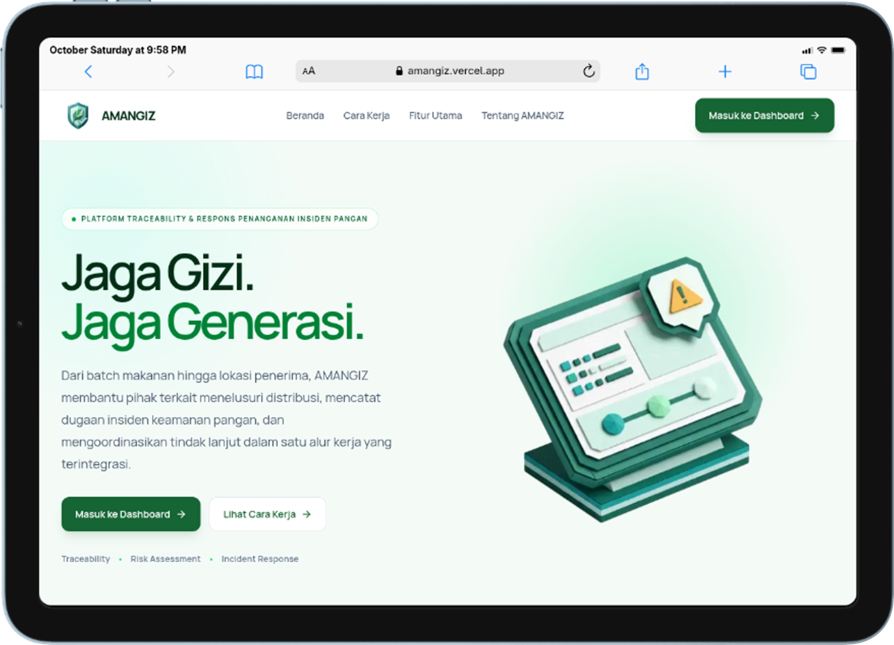

<div align="center">



# AMANGIZ — Amankan Gizi

**Food Safety & Nutrition Incident Response Platform** for the *Program Makan Bergizi Gratis* (MBG) ecosystem.

*Jaga Gizi. Jaga Generasi.*

</div>

---

## About

AMANGIZ connects food batch traceability, distribution tracking, incident reporting, rule-based risk assessment, and investigation workflows in a single operational platform — helping SPPG operators, school operators, and investigators trace a batch's history, identify which recipients need follow-up, and document the response to a suspected food-safety incident from first report to resolution.

AMANGIZ does not diagnose illness, determine incident causes automatically, or replace the authority of official health bodies — it supports the people who do that work with organized, traceable information.

**Core workflow:** `Detect → Trace → Assess → Contain → Investigate → Resolve`

## Features

| Feature | Description |
|---|---|
| **Batch Management** | Record batch identity, production info, ingredients, suppliers, and status |
| **Food Traceability** | Trace a batch from supplier → production → distribution → recipient school |
| **Distribution Tracking** | Monitor shipment schedule, dispatch, receipt, and delivery evidence |
| **Incident Reporting** | Structured reports with chronology, related batch, and supporting evidence |
| **Rule-Based Risk Assessment** | Transparent priority scoring — shows which rules triggered and what data is still missing |
| **Investigation & Response** | Assignment, timeline, findings, lab results, and corrective actions in one case record |

See [`PRD.md`](PRD.md) for the full product and technical specification, and [`PRD-LANDING-PAGE.md`](PRD-LANDING-PAGE.md) for the marketing site's copy and design spec.

## Tech Stack

| Layer | Choice |
|---|---|
| Framework | [Next.js 16](https://nextjs.org) (App Router, Turbopack) + TypeScript |
| UI | Tailwind CSS v4, Radix UI primitives, [Lucide](https://lucide.dev) icons |
| Typography | Manrope (UI) + Geist Mono (codes/timestamps), loaded via `next/font` |
| Database | MongoDB Atlas via Mongoose |
| Auth | `bcryptjs` password hashing + `jose` (JWT session cookie) |
| Validation | Zod |
| File storage | Cloudinary (evidence & documents) |
| Tooling | [Biome](https://biomejs.dev) (lint + format), [Bun](https://bun.sh) (package manager & runtime) |

## Getting Started

This project uses **Bun**, not npm/yarn/pnpm.

```bash
bun install

cp .env.example .env.local
# then fill in MONGODB_URI, SESSION_SECRET, and the CLOUDINARY_* values

bun run dev
```

Open [http://localhost:3000](http://localhost:3000) to see the landing page, and [http://localhost:3000/login](http://localhost:3000/login) for the dashboard login.

### Scripts

| Command | Purpose |
|---|---|
| `bun run dev` | Start the dev server (Turbopack) |
| `bun run build` | Production build |
| `bun run start` | Start the production server |
| `bun run lint` | Check lint + formatting with Biome |
| `bun run format` | Auto-format with Biome |

## Project Structure

```
app/                    Next.js App Router — pages + /api/v1 route handlers
components/
  ui/                   Shared UI primitives (Button, Sheet — shadcn-style, built on Radix)
  *.tsx                 Feature components (login form, mobile nav, ...)
lib/
  auth/, access/        Session handling, password hashing, authorization
  db/                   Mongoose connection
  risk-engine/          Rule-based risk assessment engine
  validations/          Zod schemas per resource
  cloudinary/           Evidence upload helpers
  audit/, notifications/, workflow/, rate-limit/, api/, utils/
models/                 Mongoose schemas (User, FoodBatch, Distribution, Incident, ...)
services/               Business logic (batch, traceability, risk assessment)
public/                 Static assets — see below
PRD.md                  Full product & technical specification
PRD-LANDING-PAGE.md     Landing page copywriting & design spec
```

## Visual Assets

`public/` holds the brand's custom 3D-illustration set (consistent teal/green, isometric papercraft style) used across the landing and auth pages:

| Asset | Used in |
|---|---|
| `Amangiz-Logo.png` | Navbar, footer, and login page branding |
| `Hero.png` | Landing page hero illustration |
| `Auth-Ilustration.png` | Login page illustration panel |
| `Informasi Terpisah.png` | "Tantangan di Lapangan" — problem card 01 |
| `Jalur Distribusi Sulit Ditelusuri.png` | "Tantangan di Lapangan" — problem card 02 |
| `Tindak Lanjut Sulit Dipantau.png` | "Tantangan di Lapangan" — problem card 03 |
| `Hubungkan data.png` | "Solusi AMANGIZ" — highlight 01 |
| `Telusuri distribusi.png` | "Solusi AMANGIZ" — highlight 02 |
| `Prioritaskan pemeriksaan.png` | "Solusi AMANGIZ" — highlight 03 |
| `Dokumentasikan respons.png` | "Solusi AMANGIZ" — highlight 04 |
| `Thumb.png` | README banner / social preview |

## Disclaimer

AMANGIZ is a prototype built for demonstration purposes. It supports record-keeping, traceability, and incident-response workflow — it does not replace medical examination, laboratory testing, or decisions made by the responsible authorities.
